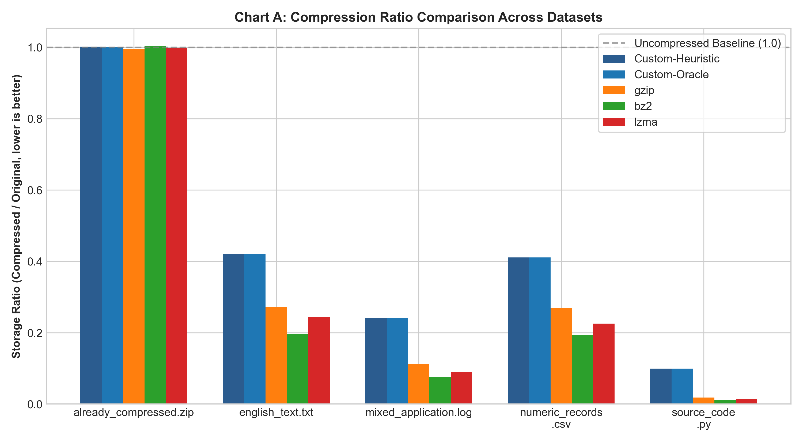
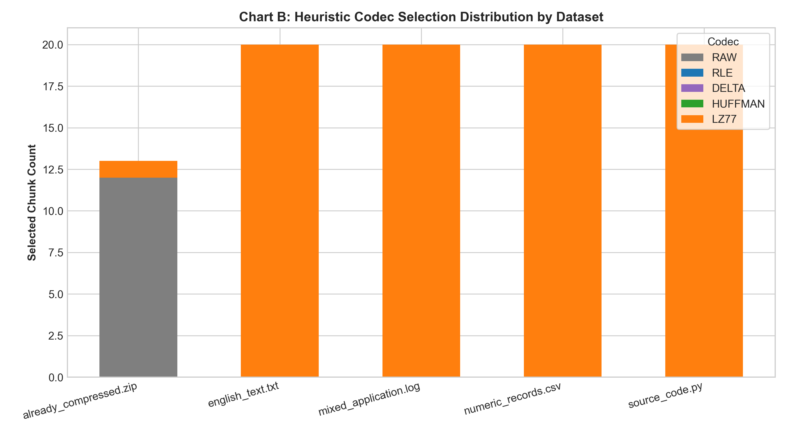
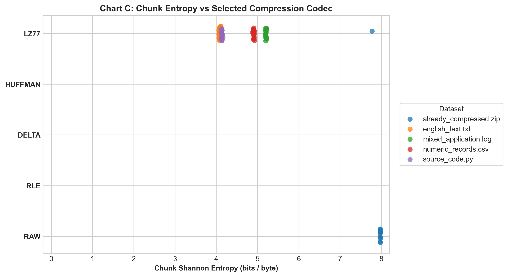
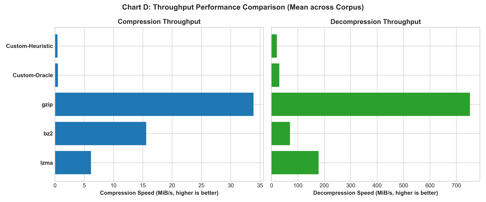
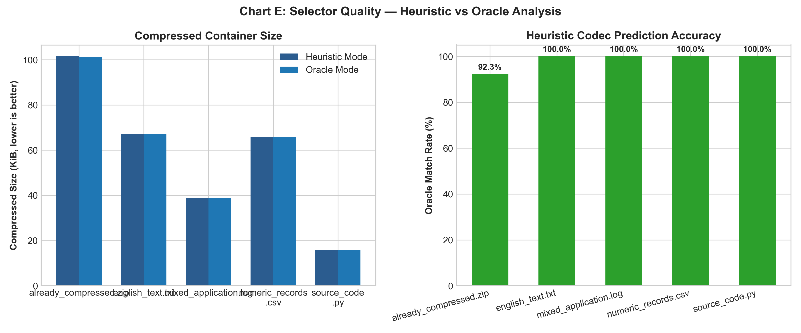

# Context-Aware Hybrid Compressor (CACZ)

[](https://www.python.org/downloads/)
[](LICENSE)
[](tests/)
[](core/)

**Context-Aware Hybrid Compressor (CACZ)** is an advanced, production-quality chunked archiver that dynamically analyzes data entropy, run-length density, delta variance, and repeated substring patterns to select the optimal compression algorithm for each individual chunk.

Built entirely from first principles in pure Python (no external C-extensions for the core compression engine), CACZ features custom implementations of **Run-Length Encoding (RLE)**, **Canonical Huffman Coding**, **Sliding-Window LZ77**, and **Modulo-256 Delta Encoding**, unified under a safe, versioned binary container with CRC32 integrity verification and atomic write guarantees.

---

## Architecture Overview

CACZ decomposes arbitrary binary input streams into configurable fixed-size chunks (default 8,192 bytes) and extracts statistical features to route each chunk to the most effective codec.

### Forward Compression Path

```
    Input File (Arbitrary Binary Stream)
                     |
                     v
             Streaming Chunker
       (Bounded Memory: 1 KiB - 1 MiB)
                     |
                     v
           Chunk Feature Analyzer
  (Shannon Entropy, Run Ratios, Delta Variance, 4-Grams)
                     |
                     v
         Heuristic / Oracle Selector
       (O(1) Rule Engine vs Speculative Search)
                     |
        +------------+------------+------------+------------+------------+
        |            |            |            |            |            |
        v            v            v            v            v            v
    [  RAW  ]    [  RLE  ]   [ HUFFMAN ]   [  LZ77 ]    [ DELTA ]   [ FALLBACK ]
    (Identity)   (Repeated)   (Skewed)    (Dictionary)   (Linear)   (Anti-Expansion)
        |            |            |            |            |            |
        +------------+------------+------------+------------+------------+
                                  |
                                  v
                    Versioned Binary Container
               (CACZ v1 Framing, CRC32 Checksums)
                                  |
                                  v
                      Atomic Output (.cacz)
```

### Reverse Decompression Path

```
    Compressed Container (.cacz)
                 |
                 v
     Header Validation & Integrity Check
         (Magic 'CACZ', Version, Header CRC32)
                 |
                 v
     Sequential Chunk Record Parsing
   (Index Ordering, Bounded Memory Allocation)
                 |
                 v
     Codec Routing & Payload Decoding
   (Raw, RLE, Huffman, LZ77, Delta Decompressors)
                 |
                 v
    Decoded Chunk CRC32 Verification
   (Bit-for-Bit Validation Against Original)
                 |
                 v
     Atomic Staging -> Reconstructed Output
```

---

## Core Algorithms Implemented

All four custom codecs operate on arbitrary 8-bit binary data (all 256 byte values) and expose a uniform public interface: `encode(data: bytes) -> bytes` and `decode(data: bytes) -> bytes`.

### 1. Run-Length Encoding (`codecs/rle.py`)
- **Mechanism**: Packet-oriented run and literal framing. A control byte discriminates between runs (`0x80 | (length - 3)` for runs of 3 to 130 bytes) and literals (`count - 1` for 1 to 128 uncompressed bytes).
- **Target Context**: Data with extensive identical byte sequences (e.g., zero-padded memory dumps, bitmap masks, sparse blocks).
- **Expansion Boundary**: At most 1 control byte per 128 literal bytes (~0.78% worst-case expansion).

### 2. Lossless Huffman Coding (`codecs/huffman.py`)
- **Mechanism**: Builds an exact byte-frequency histogram, constructs a deterministic priority-queue binary tree with canonical tie-breaking, and serializes the tree in pre-order bit notation before packing variable-length bit sequences.
- **Target Context**: Streams with skewed symbol distributions, low Shannon entropy, or restricted alphabet sizes.
- **Robustness**: Native handling of single-symbol inputs, empty payloads, and safe bitstream termination without false EOF.

### 3. Sliding-Window LZ77 (`codecs/lz77.py`)
- **Mechanism**: 4,096-byte sliding window using an accelerated bounded-chain 3-byte hash table (O(1) prefix lookup) and LZSS 8-item flag-byte command grouping.
- **Target Context**: Data containing repeated substrings, source code keywords, log templates, and natural language phrases.
- **Special Capability**: Full support for overlapping matches (`length > offset`), allowing high-ratio expansion of repeated patterns.

### 4. Modulo-256 Delta Encoding (`codecs/delta.py`)
- **Mechanism**: Discrete adjacent byte differentiation $t_i = (d_i - d_{i-1}) \pmod{256}$, coupled with run-length difference packing.
- **Target Context**: Monotonic sequence counters, timestamps, sensor telemetry, and tabular columnar metrics.
- **Theoretical Note**: Delta transformation alone is an information-preserving bijection that does *not* reduce byte count; compression is achieved because structured deltas collapse into long runs of constants (e.g., runs of +1 or 0).

### 5. Raw Fallback Codec (`core/codecs/__init__.py`)
- Acts as a zero-overhead pass-through when data is incompressible or when an algorithm produces an encoded size larger than the original chunk.

---

## Chunk Feature Analysis & Selection Engine

### Feature Extraction (`core/analyzer.py`)
For each chunk, the analyzer computes eight mathematical metrics:
1. **Shannon Entropy ($H$)**: $-\sum p_i \log_2(p_i)$ in bits/byte $[0.0, 8.0]$.
2. **Run-Length Ratio**: Proportion of bytes participating in runs of $\ge 3$ identical bytes.
3. **Repeated-Substring Ratio**: Sliding 4-gram redundancy ratio.
4. **Byte-Delta Variance**: Statistical variance of modulo-256 adjacent byte deltas.
5. **Delta-Run Ratio**: Proportion of adjacent differences forming runs of $\ge 3$ identical deltas.
6. **Unique-Byte Count**: Total distinct symbols present ($1 \le K \le 256$).
7. **Top-Byte Concentration**: Cumulative proportion accounted for by the 4 most frequent bytes.
8. **Chunk Length**: Uncompressed chunk size in bytes.

### Selection Strategies (`core/selector.py`)

- **Heuristic Mode (`--mode heuristic`)**: Evaluates extracted chunk features in $O(1)$ time to predict the best codec without speculative compression.
  - Predicts **RLE** if run-length ratio $\ge 0.40$.
  - Predicts **DELTA** if delta-run ratio $\ge 0.50$ (monotonic sequences).
  - Predicts **LZ77** if repeated-substring ratio $\ge 0.35$ and exceeds run-length ratio.
  - Predicts **HUFFMAN** if entropy $< 6.8$ or top-4 concentration $\ge 0.45$.
  - Predicts **RAW** if entropy $\ge 7.85$ and repeated substrings $< 0.15$ (encrypted/random data).
  - Safety check: If the predicted codec expands the chunk, the engine automatically falls back to uncompressed RAW storage.

- **Oracle Mode (`--mode oracle`)**: Speculatively compresses each chunk with all candidate codecs, measures the exact byte payloads including container framing, and selects the mathematically minimal representation. Serves as the ground-truth benchmark for evaluating heuristic selection accuracy.

---

## Binary Container Format (CACZ v1)

CACZ files use a strictly defined, big-endian binary framing format:

```
+-----------------------------------------------------------------------+
|                         FILE HEADER (28 Bytes)                        |
|  Magic (4B)  | Version (2B) | Flags (2B) | ChunkSize (4B) | Total (4B)|
|  b'CACZ'     |    0x0001    |  0x0000/1  |  Default 8192  |  Count N  |
|  OrigSize (8B uint64)       | Header CRC32 Checksum (4B uint32)       |
+-----------------------------------------------------------------------+
|                      CHUNK RECORD #0 (18B + Payload)                   |
|  Index (4B)  | CodecID (1B) | Flags (1B) | OrigLen (4B) | EncLen (4B) |
|  Data CRC32 (4B uint32)     | Encoded Payload (EncLen Bytes)          |
+-----------------------------------------------------------------------+
|                                  ...                                  |
+-----------------------------------------------------------------------+
|                      CHUNK RECORD #N-1 (18B + Payload)                 |
+-----------------------------------------------------------------------+
```

### Safety and Security Features:
- **Exact Round-Trip Verification**: Bit-for-bit identity verified by per-chunk CRC32 and total file size checks.
- **Bounded Memory Allocation**: Strictly enforces chunk size limits to prevent memory exhaustion attacks from malicious headers.
- **Atomic File Operations**: Decompression writes to an isolated temporary staging file and renames it only after complete verification. Corrupted streams leave zero partial files on disk.
- **Trailing Garbage Detection**: Rejects containers with extra bytes appended past the final chunk record.

---

## Installation & Setup

### Prerequisites
- Python 3.10, 3.11, 3.12, or 3.13.
- Standard CPython distribution (Windows, Linux, macOS).

### 1. Clone the Repository
```bash
git clone https://github.com/your-username/context-aware-compressor.git
cd context-aware-compressor
```

### 2. Create and Activate Virtual Environment

**Windows (PowerShell):**
```powershell
python -m venv .venv
.\.venv\Scripts\Activate.ps1
```

**Linux / macOS (Bash):**
```bash
python3 -m venv .venv
source .venv/bin/activate
```

### 3. Install Dependencies
```bash
pip install -r requirements.txt
```
*(Note: Core compression, decompression, inspection, and test suite require only Python's standard library. NumPy and Matplotlib are used exclusively for running benchmarks and generating charts.)*

---

## CLI Usage Guide

The application provides a unified CLI via `compressor.py`:

### 1. Compress a File
```bash
# Heuristic mode (fast, single-pass feature prediction)
python compressor.py compress input.txt output.cacz --mode heuristic

# Oracle mode (exhaustive candidate evaluation for maximum compression)
python compressor.py compress input.txt output.cacz --mode oracle

# Custom chunk size (e.g. 16 KiB)
python compressor.py compress input.txt output.cacz --chunk-size 16384 --verbose
```

### 2. Decompress a Container
```bash
python compressor.py decompress output.cacz reconstructed.txt
```

### 3. Inspect Container Metadata & Codec Distribution
```bash
python compressor.py inspect output.cacz --verbose
```

### 4. Run Benchmark Suite
```bash
python compressor.py benchmark benchmark/test_files --output-dir benchmark/results
```

---

## Verified Benchmark Results

The following measurements were collected on **Windows 11 (AMD64)** running **Python 3.13.7** with default chunk size (8,192 bytes):

| Dataset | Method | Original Size | Compressed Size | Storage Ratio | Space Saved | Comp Speed | Dec Speed | Verified |
|:---|:---|---:|---:|---:|---:|---:|---:|:---:|
| `already_compressed.zip` | **Custom-Heuristic** | 103,727 B | 103,900 B | **1.0017** | -0.17% | 0.39 MiB/s | 62.31 MiB/s | **YES** |
| `already_compressed.zip` | **Custom-Oracle** | 103,727 B | 103,814 B | **1.0008** | -0.08% | 0.40 MiB/s | 101.40 MiB/s | **YES** |
| `already_compressed.zip` | gzip | 103,727 B | 103,168 B | 0.9946 | +0.54% | 45.17 MiB/s | 980.39 MiB/s | **YES** |
| `already_compressed.zip` | bz2 | 103,727 B | 103,984 B | 1.0025 | -0.25% | 12.46 MiB/s | 26.08 MiB/s | **YES** |
| `already_compressed.zip` | lzma | 103,727 B | 103,624 B | 0.9990 | +0.10% | 5.08 MiB/s | 45.36 MiB/s | **YES** |
| `english_text.txt` | **Custom-Heuristic** | 163,840 B | 68,765 B | **0.4197** | **+58.03%** | 0.37 MiB/s | 8.39 MiB/s | **YES** |
| `english_text.txt` | **Custom-Oracle** | 163,840 B | 68,765 B | **0.4197** | **+58.03%** | 0.48 MiB/s | 7.86 MiB/s | **YES** |
| `english_text.txt` | gzip | 163,840 B | 44,680 B | 0.2727 | +72.73% | 6.60 MiB/s | 327.57 MiB/s | **YES** |
| `english_text.txt` | bz2 | 163,840 B | 32,206 B | 0.1966 | +80.34% | 17.49 MiB/s | 53.85 MiB/s | **YES** |
| `english_text.txt` | lzma | 163,840 B | 39,920 B | 0.2437 | +75.63% | 3.61 MiB/s | 91.83 MiB/s | **YES** |
| `mixed_application.log` | **Custom-Heuristic** | 163,840 B | 39,687 B | **0.2422** | **+75.78%** | 0.48 MiB/s | 13.41 MiB/s | **YES** |
| `mixed_application.log` | **Custom-Oracle** | 163,840 B | 39,687 B | **0.2422** | **+75.78%** | 0.56 MiB/s | 13.03 MiB/s | **YES** |
| `mixed_application.log` | gzip | 163,840 B | 18,199 B | 0.1111 | +88.89% | 37.08 MiB/s | 504.19 MiB/s | **YES** |
| `mixed_application.log` | bz2 | 163,840 B | 12,321 B | 0.0752 | +92.48% | 16.15 MiB/s | 89.27 MiB/s | **YES** |
| `mixed_application.log` | lzma | 163,840 B | 14,612 B | 0.0892 | +91.08% | 5.32 MiB/s | 172.27 MiB/s | **YES** |
| `numeric_records.csv` | **Custom-Heuristic** | 163,840 B | 67,344 B | **0.4110** | **+58.90%** | 0.42 MiB/s | 8.99 MiB/s | **YES** |
| `numeric_records.csv` | **Custom-Oracle** | 163,840 B | 67,344 B | **0.4110** | **+58.90%** | 0.52 MiB/s | 9.43 MiB/s | **YES** |
| `numeric_records.csv` | gzip | 163,840 B | 44,229 B | 0.2700 | +73.00% | 14.78 MiB/s | 314.77 MiB/s | **YES** |
| `numeric_records.csv` | bz2 | 163,840 B | 31,687 B | 0.1934 | +80.66% | 19.73 MiB/s | 56.31 MiB/s | **YES** |
| `numeric_records.csv` | lzma | 163,840 B | 36,912 B | 0.2253 | +77.47% | 4.21 MiB/s | 75.67 MiB/s | **YES** |
| `source_code.py` | **Custom-Heuristic** | 163,840 B | 16,334 B | **0.0997** | **+90.03%** | 0.59 MiB/s | 16.17 MiB/s | **YES** |
| `source_code.py` | **Custom-Oracle** | 163,840 B | 16,334 B | **0.0997** | **+90.03%** | 0.62 MiB/s | 15.93 MiB/s | **YES** |
| `source_code.py` | gzip | 163,840 B | 3,005 B | 0.0183 | +98.17% | 69.77 MiB/s | 1257.04 MiB/s | **YES** |
| `source_code.py` | bz2 | 163,840 B | 1,997 B | 0.0122 | +98.78% | 15.00 MiB/s | 142.20 MiB/s | **YES** |
| `source_code.py` | lzma | 163,840 B | 2,280 B | 0.0139 | +98.61% | 13.73 MiB/s | 535.10 MiB/s | **YES** |

*Definitions: Storage Ratio = Compressed / Original (lower is better). Space Saved = (1 - Storage Ratio) * 100%.*

---

## Generated Visualizations

The automated benchmark suite generates five analytical charts saved to `benchmark/results/charts/`:

### Chart A: Compression Ratio Comparison

*Comparison of storage ratios across datasets. The dashed gray line marks the uncompressed baseline (1.0).*

### Chart B: Codec Selection Distribution

*Stacked breakdown of selected codecs under heuristic mode across datasets.*

### Chart C: Chunk Entropy vs Selected Codec

*Scatter distribution showing how chunk Shannon entropy correlates with codec selection.*

### Chart D: Throughput Performance Comparison

*Mean compression and decompression throughput in MiB/s across the benchmark corpus.*

### Chart E: Heuristic vs Oracle Selector Quality

*Container size comparison and prediction accuracy rate of the heuristic selector against the oracle.*

---

## Testing & Quality Assurance

CACZ includes an extensive automated test suite covering all four codecs, boundary cases, corruption handling, container integrity, and integration CLI execution:

```bash
# Run full automated test suite (86 tests)
python -m unittest discover tests -v
```

### Test Coverage Highlights:
- **`tests/test_codecs.py`** (51 tests): Tests every codec against empty inputs, single-byte payloads, all 256 byte values, random noise, monotonic sequences, long repeated runs, truncation, and bitflip corruption.
- **`tests/test_container.py`** (7 tests): Validates empty files, sub-chunk files, exact multiples of chunk size, multi-chunk files, and atomic file safety.
- **`tests/test_selector.py`** (10 tests): Tests feature extraction accuracy, threshold triggering, and oracle minimization invariants.
- **`tests/test_corruption.py`** (12 tests): Verifies rejection of bad magic bytes, version mismatches, CRC32 discrepancies, out-of-order chunks, memory explosion claims, and verifies that no partial output files are leaked on failure.
- **`tests/test_integration.py`** (6 tests): End-to-end subprocess testing of CLI commands, flags, determinism, and exit codes.

---

## Known Trade-offs & Engineering Reality

1. **Pure Python Execution Speed**: As an educational and demonstration system written purely in Python without C extensions, compression throughput is ~0.4 to 0.6 MiB/s, compared to compiled C baselines (gzip at 40-70 MiB/s).
2. **Incompressible Expansion Overhead**: As demonstrated on `already_compressed.zip`, high-entropy data cannot be compressed losslessly. The container's RAW fallback limits expansion to the minimal framing overhead (28-byte file header + 18-byte chunk headers, or +0.17% total).
3. **Chunk Boundary Limitations**: Fixed chunking (8,192 bytes) resets dictionary state between chunks, preventing cross-chunk match references that whole-stream archivers like gzip and bz2 can exploit.
4. **Standard Library Namespace Resolution**: Python's built-in `codecs` module resides at `sys.modules['codecs']`. To avoid collisions when importing, the implementation packages the compression engines under `core.codecs` while maintaining the root `codecs/` layout requested for standalone inspection.

---

## License

This project is licensed under the MIT License - see the [LICENSE](LICENSE) file for details.
